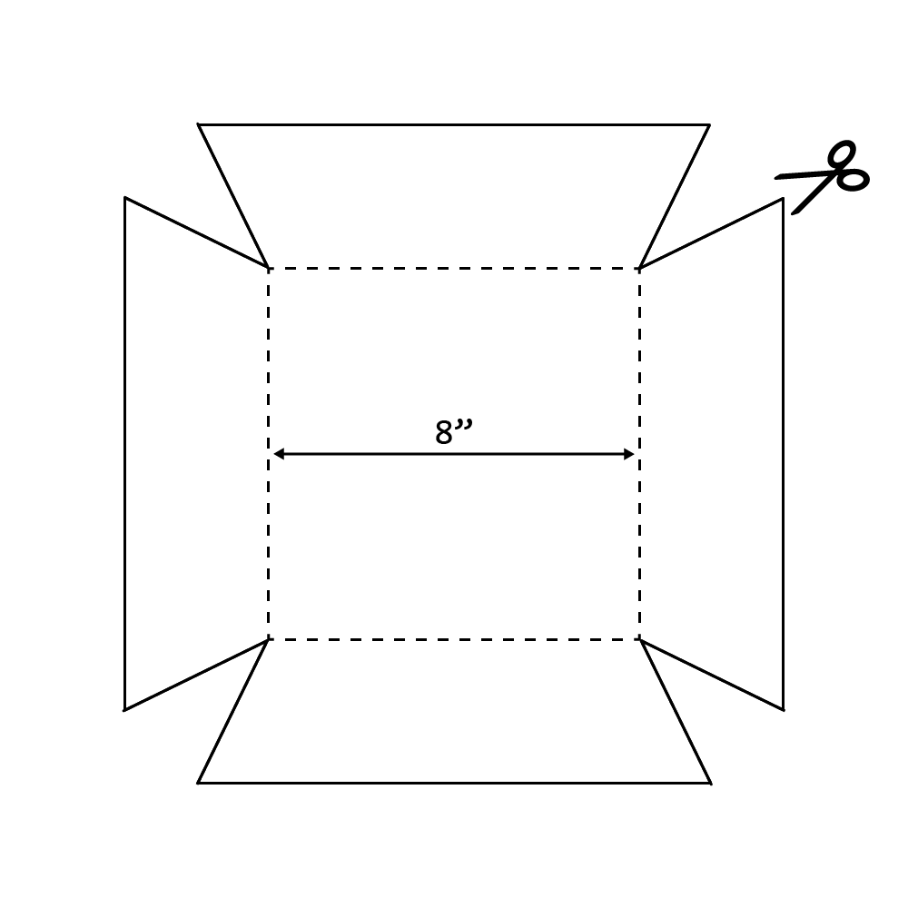

# John Brownies
A substantial brownie, with nuts.
## Sources:
[article](https://www.loveandlemons.com/brownies-recipe/)
## Ingredients:
- a bit of butter
### Dry:
- 1.5 cups granulated sugar (sub in some for powdered sugar as an experiment)
- 3/4 cups flour
- 2/3 cup cocoa powder
- 3/4 tsp salt
- 1/2 or 3/4 cup of pecans
- 1/2 cup chocolate chips (semi-sweet)
### Wet:
- 2 eggs (large)
- 2 tbsp water
- 1/2 tsp vanilla
- 1/2 cup olive oil (extra virgin) (vegetable oil also works fine)
## Instructions:
### Prep:
- get an 8 inch by 8 inch high-walled bake pan (glass is best)
- rub a thin coat of butter all over it
- cut parchment paper so that you have foldable flaps and an 8" base that you can create a volume with, like so:

- put the parchment paper volume into the baking pan and stick it to the tray with the butter
- you can even use a bit of extra butter to get the folded corners to stick together!
### Main Process:
- mix dry ingredients in large bowl
- mix wet ingredients in small bowl (make sure to disperse eggs well)
- mix dry and wet in large bowl
- _the mix will be thick and grainy. this is fine_
- pour into tray, smooth out
- bake for 43 minutes @ 325 degrees
- bake for a few more if a cake tester cannot come out mostly clean